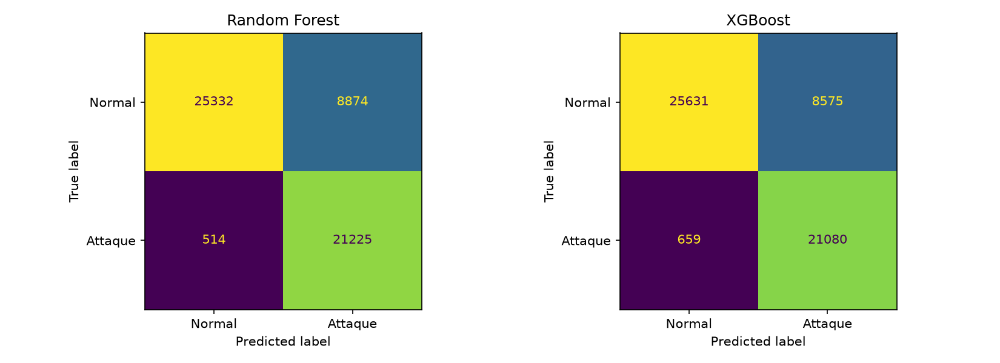
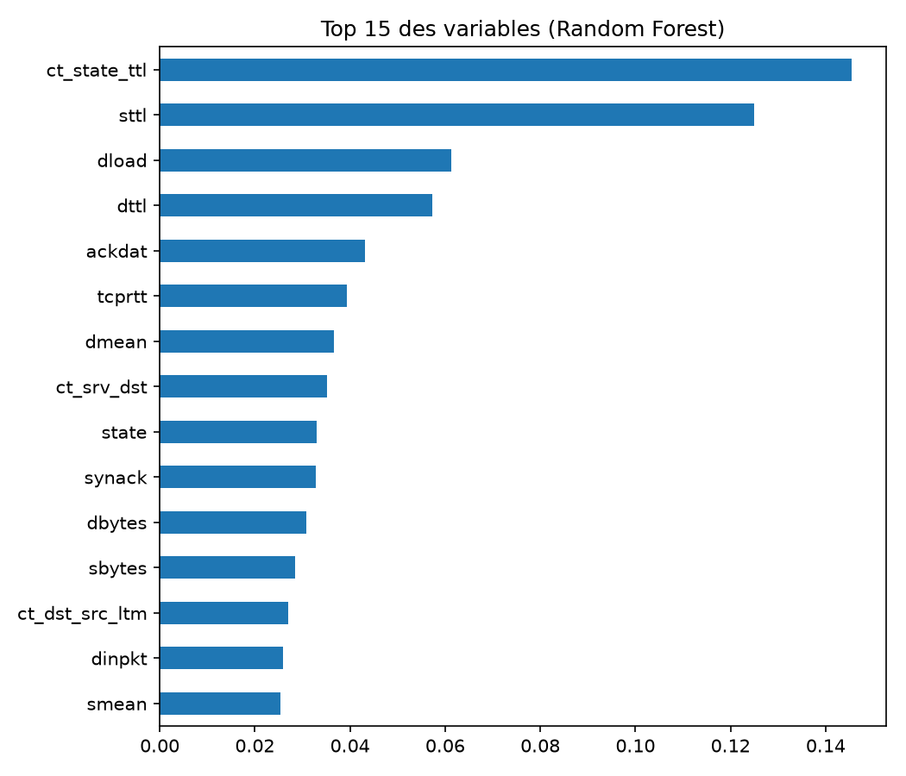

# AI-Powered SOC Assistant

Détection d'attaques réseau par machine learning, pensée comme brique d'un
centre opérationnel de sécurité (SOC) : classification du trafic, évaluation
orientée risque, tableau de bord et explication des alertes par un LLM local.

## Contexte
Un analyste SOC reçoit des milliers d'alertes. Ce projet étudie jusqu'où un
modèle peut détecter les attaques tout en limitant les fausses alertes, et comment
un LLM local peut aider à les expliquer sans qu'aucune donnée ne quitte la machine.

## Données
UNSW-NB15 : fichiers `training-set` et `testing-set` à placer dans `data/`.
Le trafic est étiqueté normal ou attaque, avec la catégorie d'attaque
(DoS, Exploits, Reconnaissance, etc.).

## Méthodologie
1. **Exploration** : répartition des classes, valeurs manquantes, doublons.
2. **Prétraitement** : suppression de `id` et des doublons, encodage ordinal de
   `proto`, `service`, `state` ajusté sur le train uniquement, exclusion de
   `label` et `attack_cat` des entrées (pas de fuite de données).
3. **Modélisation** : Random Forest et XGBoost.
4. **Évaluation** : Precision, Recall, F1, matrices de confusion, étude du
   seuil de décision.
5. **Tableau de bord** : application Streamlit avec seuil réglable.
6. **Explication des alertes** : LLM local (Qwen via LM Studio) avec
   correspondance indicative MITRE ATT&CK.

## Résultats (seuil 0,5)

| Modèle | Precision (Attaque) | Recall (Attaque) | F1 | Accuracy |
|---|---|---|---|---|
| Random Forest | 0,71 | 0,98 | 0,82 | 0,83 |
| XGBoost | 0,71 | 0,97 | 0,82 | 0,83 |

**Lecture :** plus de 97 % des attaques sont détectées, mais environ 26 % du
trafic normal est signalé à tort. Cet écart est en partie lié à la différence
de distribution entre les fichiers train et test d'UNSW-NB15.

## Tableau de bord
Le curseur de seuil montre en direct le compromis entre Precision et Recall.
Chaque alerte peut être expliquée par un LLM local, sans envoi de données vers
l'extérieur.

## Tests et évaluation
- Tests automatiques du pipeline (`pytest tests`) : absence de fuite de données,
  données propres, mêmes colonnes en train et test, qualité minimale du modèle,
  probabilités valides, robustesse face à une catégorie inconnue.
- Évaluation qualitative des explications du LLM sur 7 alertes :
  voir `docs/evaluation_llm.md`. Elle a révélé des attributions erronées de la
  catégorie au modèle et une mauvaise lecture du champ `state`, corrigées dans
  le prompt.

## Structure

    ai-soc-assistant/
    ├── app/         tableau de bord Streamlit
    ├── notebooks/   exploration, prétraitement, entraînement
    ├── src/         preprocess.py, train.py, explain.py
    ├── tests/       tests automatiques
    ├── docs/        figures et évaluation du LLM
    ├── data/        jeux de données (non versionnés)
    └── models/      modèles sauvegardés (non versionnés)

## Lancer le projet

    python -m venv .venv
    .venv\Scripts\Activate.ps1
    pip install -r requirements.txt
    python src/train.py
    streamlit run app/app.py

Pour les explications : démarrer le serveur local de LM Studio (port 1235)
avec un modèle chargé, puis adapter `MODEL` dans `src/explain.py`.

## Limites et suite
- La catégorie d'attaque affichée provient de l'étiquette du jeu de données, non
  d'une prédiction. La correspondance avec MITRE ATT&CK est indicative.
- Faux positifs élevés : réglage du seuil et analyse par type d'attaque.
- Le modèle exige les variables exactes d'UNSW-NB15 : il ne peut pas analyser
  directement une capture réseau brute.
- Prochaines étapes : modèle multi-classes pour prédire le type d'attaque,
  simulation de trafic en direct, réentraînement sur un jeu reproductible
  (CICIDS2017) et conteneurisation Docker.

## Auteur
Mohamed Yassine Miladi, étudiant ingénieur en informatique (cloud et
cybersécurité), ESPRIT.